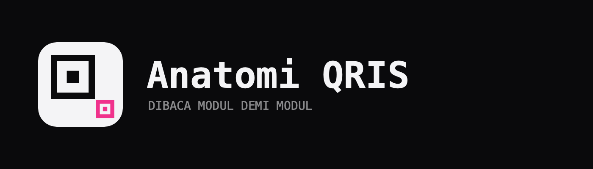
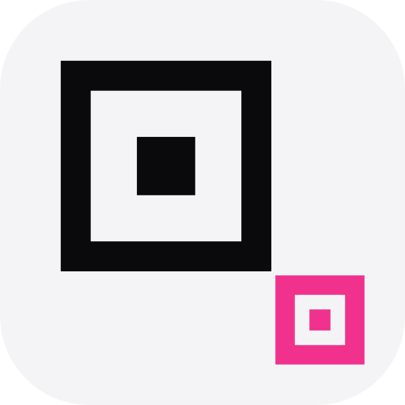

<div align="center">

<picture>
  <source media="(prefers-color-scheme: dark)" srcset="docs/brand/lockup-dark.png" />
  <source media="(prefers-color-scheme: light)" srcset="docs/brand/lockup-light.png" />
  
</picture>

**How a QR code is built, and what a QRIS payload says.**

[**Open the app →**](https://andifathulms.github.io/anatomi-qris/)

[](https://github.com/andifathulms/anatomi-qris/actions/workflows/ci.yml)
[](https://github.com/andifathulms/anatomi-qris/actions/workflows/deploy.yml)


</div>

---

Two questions, one engine. A string of text becomes a grid of black squares —
almost everyone has scanned tens of thousands of QR codes and nobody has seen
one built. And the QRIS sticker on the counter is not an opaque token: it is a
plainly structured string naming the merchant, the acquirer, the category of
business, the currency, and a checksum.

The app answers both because they are the same object at two layers. Select
"merchant name" in the payload tree and the specific black squares encoding
those bytes light up in the matrix. That mapping is the product.

> `PRD.md` is what and why. `DESIGN.md` is how it looks. `CLAUDE.md` is how it
> is built.

## The nine stages

| # | Stage | What you watch happen |
|---|-------|----------------------|
| 1 | Payload | The string, and — if it is QRIS — its TLV tree |
| 2 | Analyse | Mode selection, version, capacity |
| 3 | Encode | Characters become a bitstream, with every span named |
| 4 | Divide | Reed-Solomon long division, one step at a time |
| 5 | Interleave | Blocks comb together into the final codeword order |
| 6 | Place | The zigzag walk fills the matrix, module by module |
| 7 | Mask | Eight candidates, four penalty rules, one winner |
| 8 | Finish | Format and version information, the finished symbol |
| 9 | Damage | Break it, and watch Reed-Solomon put it back |

The stage rail is a slider, not a row of tabs: dragging it moves through the
stages continuously, so halfway between *place* and *mask* shows the zigzag
complete and the mask half applied.

## The interface

Two registers that never blur. The **specimen** is pure black on pure white
with hard pixel edges, no radius and no shadow, because a QR code is a printed
object and anything else would be a lie about the material. The **instrument**
is everything around it: dark by default, light on request, and forbidden from
using either pure black or pure white — when you see white on this screen you
are looking at paper.

The specimen sits in the middle and never moves, because nine stages must read
as one object being transformed rather than nine illustrations in a row. The
panel on the right changes around it, and the payload field holds the bottom
edge.

Colour has a budget: ten module roles split warm for structure and cool for
content, two functional colours for damage and repair, and one marker hue for
selection — which is the same magenta whether the thing selected is a codeword
in the ribbon, a row in the payload tree, a mask card, or a module in the
matrix. Nothing else gets a hue.

## Running it

```bash
npm install
npm run dev        # development server
npm test           # full suite, including the oracle
npm run build      # production build into dist/
node scripts/check-bundle.mjs   # bundle budget and the no-network check
```

Node 22 or newer.

## How it is built

The QR engine is written from scratch. `qrcode` and `jsqr` are devDependencies
used only to check our work; a test fails if either is imported from `src/`.

`src/engine/` is pure — no React, no DOM, no randomness, no clock, and it
imports nothing but its own siblings. It produces a `Build`: the matrix, plus a
complete record of what caused every module to be the colour it is. Every view
reads that one structure. Nothing recomputes geometry, so nothing can drift.

| File | Does |
|------|------|
| `gf256.ts` | log/antilog tables, field arithmetic, polynomial operations |
| `reed-solomon.ts` | encoder with a step-by-step division trace, and a decoder |
| `tables.ts` | the capacity table, with BCH and alignment rules computed |
| `segments.ts` | mode selection and bitstream assembly, recording each span |
| `blocks.ts` | block splitting and interleaving |
| `matrix.ts` | function patterns and the zigzag walk, recording roles as it goes |
| `mask.ts` | eight patterns, four penalty rules, selection |
| `provenance.ts` | the reverse maps: codeword to modules, payload byte to codeword |
| `decode.ts` | read modules, correct, return bytes |

`src/qris/` parses EMVCo merchant-presented mode: TLV, the CRC16 under tag 63,
and a dictionary of tag meanings, acquirer identifiers and merchant category
codes.

## Correctness

The oracle gate is byte-identical agreement with `qrcode` across versions 1–15,
all four EC levels, all three modes, both sides of every version boundary, and
all eight mask patterns. Every generated symbol also round-trips through `jsQR`
and through our own decoder, and damage recovery is checked at exactly the
stated capacity with documented failure one codeword past it.

The provenance round trip is the test the app rests on: take a byte range,
resolve it to codewords, resolve those to modules, read exactly those modules
out of the finished matrix, undo the mask, and confirm the bytes come back.

<details>
<summary><b>One deliberate departure from the reference</b></summary>

<br />

The two implementations disagree on mask penalty rule 4, and only on rule 4.
`qrcode` rates the dark-module deviation with `ceil(|pct - 50| / 5)`; ISO/IEC
18004 Table 11 — and ZXing — use the floor. At 51.7% dark the spec charges
nothing and `qrcode` charges 10, which is enough to change which mask wins, so
the two build different but equally valid symbols.

Our engine follows the specification. The oracle therefore forces the mask and
agrees on all eight, which is a stronger claim about the construction than
agreeing on one, and checks rules 1–3 against `qrcode`'s own penalty functions,
the selection rule, and the rule 4 step size separately.

</details>

## Commitments

Nothing leaves the device. There are no runtime network requests, no analytics,
no error reporting; the fonts are bundled from `node_modules`. `check-bundle.mjs`
scans the built output for network APIs and unexpected URLs, so a dependency
cannot introduce a request we never wrote.

The app explains; it does not forge. It generates codes only from what you type
or from the bundled samples, and offers no payload editing — no amount
injection, no tag rewriting, no static-to-dynamic conversion.

Typed text and the EC level serialise to the URL so a specific input is
linkable. A pasted QRIS payload never does, and the copy-link action disappears
while the lens is active, so a merchant identifier cannot ride along in a link
someone shares without thinking.

## The mark



A QR finder pattern at the real 1:1:3:1:1 module ratio, with a 5×5 alignment
pattern beside it in cursor magenta — the part under inspection. The finder is
what a scanner looks for first, so it is the honest atom of the subject. It is
never a scannable code: that would get scanned, and it would imply this is a
payment product. It is not. It reads codes.

<br clear="left" />

## Deployment

GitHub Pages via Actions. CI runs typecheck, the full suite including the
oracle, the build and the bundle budget; deploy runs the same and publishes only
on green. `vite.config.ts` sets `base` to the repo path, overridable with
`BASE_PATH`.

---

<div align="center">
<sub>Designed & built by <a href="https://andifathulms.github.io/en/">Andi Fathul Mukminin</a></sub>
</div>
